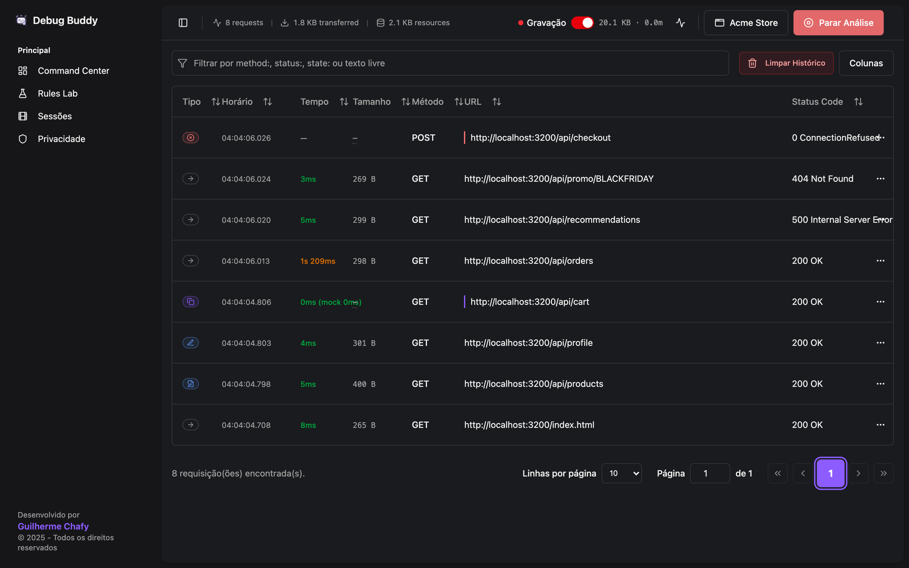
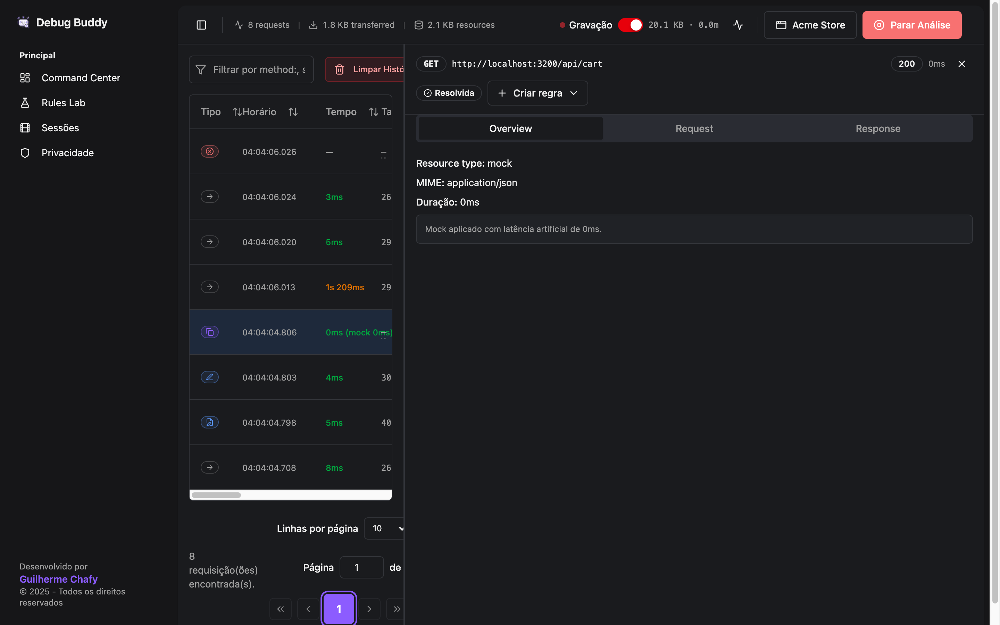
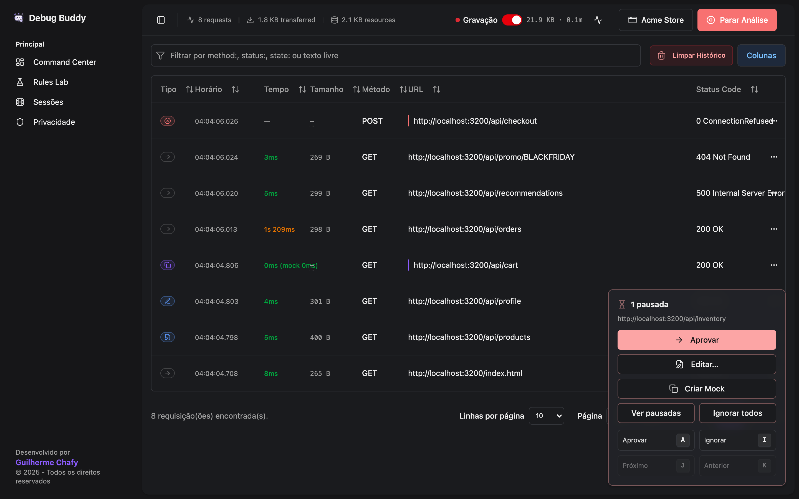
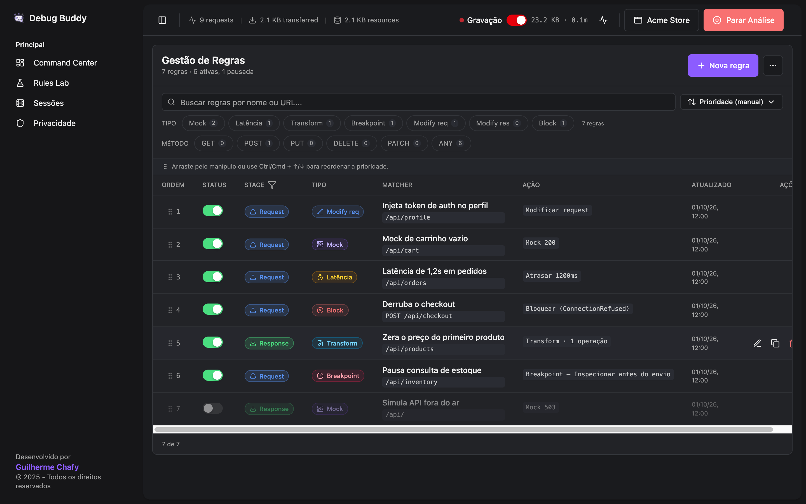
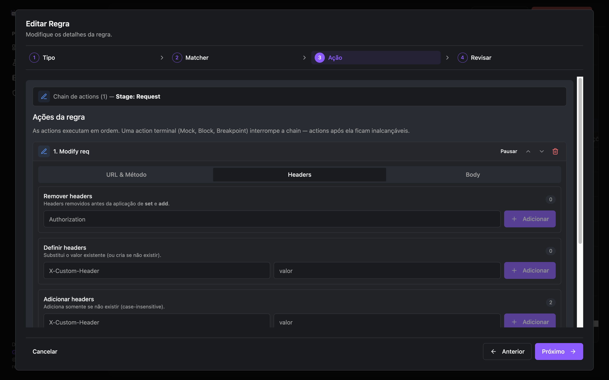
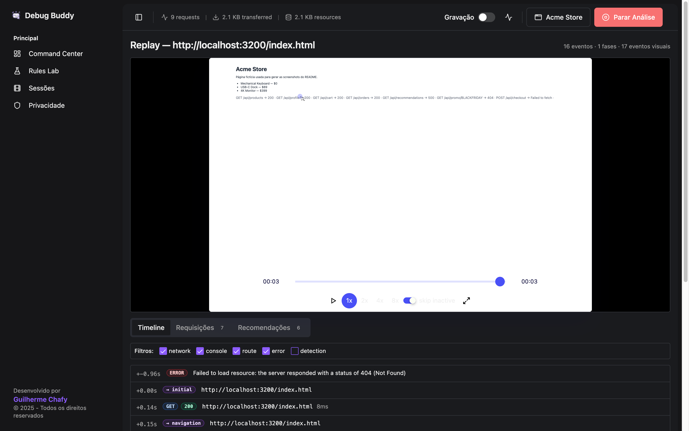

# Debug Buddy

[English](README.md)

Debug Buddy é uma extensão Chrome Manifest V3 que intercepta, modifica, mocka
e pausa o tráfego HTTP de uma aba do navegador, para você ver como a sua
aplicação web se comporta quando uma API falha, fica lenta ou muda o contrato —
sem mexer no backend, no código do frontend ou no ambiente.

Ela controla o Chrome DevTools Protocol (domínios `Fetch` e `Network`) via
`chrome.debugger`, então funciona com qualquer página, framework ou cliente
HTTP.



> A interface está em português (pt-BR). A internacionalização é acompanhada na
> [#3](https://github.com/guichafy/chrome-extension-debug-buddy/issues/3).

## Para que serve

Use o Debug Buddy para reproduzir, sob demanda, situações difíceis de obter de
um backend real:

- um endpoint retorna `500`, `503`, `404`, `401` ou qualquer outro status;
- uma requisição demora segundos a mais que o normal;
- o body foge do contrato esperado (campo ausente, tipo errado, valor zerado);
- uma requisição nunca chega ao servidor (conexão recusada, abortada, offline);
- um header precisa ser injetado ou removido (token de auth, feature flag);
- uma API ainda não existe e precisa de mock durante o desenvolvimento;
- você precisa pausar uma requisição, olhar o conteúdo e decidir o que acontece.

## Início rápido

Este repositório ainda não aponta para uma página pública na Chrome Web Store,
então instale a partir do código-fonte:

```bash
cd app
npm install
npm run build
```

1. Abra `chrome://extensions` e ative o **Modo do desenvolvedor**.
2. Clique em **Carregar sem compactação** e selecione a pasta `app/dist/`.
3. Clique no ícone do Debug Buddy na barra do Chrome. A interface abre em uma
   aba própria; ela também fica disponível no Side Panel do Chrome.
4. No cabeçalho, escolha a **aba alvo** — a aplicação que você quer depurar.
5. Clique em **Iniciar Análise**. O Chrome mostra a barra "começou a
   depurar este navegador" na aba alvo; isso é esperado.
6. Use a aplicação normalmente e acompanhe o tráfego no **Command Center**.
7. Clique em **Parar Análise** ao terminar. Qualquer requisição ainda
   pausada é liberada antes de o debugger ser desanexado.

## Tour pelas funcionalidades

### Command Center — tráfego ao vivo

Toda requisição da aba alvo aparece em uma única tabela com o tipo de
interceptação (pass-through, mock, modificada, transform, atraso, bloqueio,
breakpoint), duração, tamanho, método, URL e status. O cabeçalho mostra
métricas ao vivo (requisições, bytes transferidos, recursos) e a barra de
filtro aceita `method:`, `status:`, `state:` ou texto livre. O histórico fica
salvo no IndexedDB, então sobrevive ao fechamento da interface.

Clique em uma linha para abrir o **inspector** com as abas Overview, Request e
Response, além da aba **Modificações** sempre que uma regra reescreveu a
request ou a response. **Criar regra** transforma uma captura real em uma
regra pré-preenchida.



### Breakpoints — pausar, inspecionar, decidir

A ação `breakpoint` segura a requisição — antes do envio ou depois que o
servidor respondeu — até você agir. O dock de pendentes permite **Aprovar**,
**Editar…** (status, headers e body antes de liberar), **Criar Mock** ou
ignorar. Atalhos de teclado: <kbd>A</kbd> aprova, <kbd>I</kbd> ignora,
<kbd>J</kbd>/<kbd>K</kbd> próxima/anterior.



### Rules Lab — regras de interceptação

As regras são ordenadas por prioridade (arraste, ou <kbd>Ctrl/Cmd</kbd> +
<kbd>↑/↓</kbd>), podem ser pausadas individualmente e filtradas por tipo e
método HTTP. Cada regra casa por URL (substring ou regex), método, header e
body, e executa uma **chain ordenada de ações** em um stage:

| Stage | Quando roda | Ações |
|---|---|---|
| `request` | antes de a requisição sair do navegador | `requestModify`, `requestDelay`, `mock`, `block`, `breakpoint` |
| `response` | depois que o servidor respondeu | `responseModify`, `transform`, `mock`, `breakpoint` |

`mock`, `block` e `breakpoint` são **terminais**: encerram a chain, então
precisam ser a última ação. As regras podem ser exportadas e importadas em
JSON; a importação valida essas invariantes.



O editor de regras passa por **Tipo** (tipo e stage), **Matcher**, **Ação** e
**Revisar**:



#### Exemplo de regra

```json
{
  "id": "00000000-0000-0000-0000-000000000001",
  "name": "Injeta auth e mocka /api/users",
  "enabled": true,
  "stage": "request",
  "matchers": [
    { "type": "url", "enabled": true, "pattern": "/api/users", "isRegex": false }
  ],
  "actions": [
    {
      "type": "requestModify",
      "enabled": true,
      "addHeaders": { "Authorization": "Bearer test-token" }
    },
    {
      "type": "mock",
      "enabled": true,
      "status": 200,
      "headers": { "Content-Type": "application/json" },
      "body": "{\"users\":[]}"
    }
  ],
  "createdAt": 1715000000000,
  "updatedAt": 1715000000000
}
```

`requestModify` reescreve os headers e a ação terminal `mock` responde sem
tocar a rede. Para agir sobre o que o servidor devolveu (forçar um `503`,
alterar um campo do JSON com `transform`), use `"stage": "response"`.

### Sessões — Session Replay

Com a interceptação ligada, o Debug Buddy grava a aba alvo com
[rrweb](https://github.com/rrweb-io/rrweb) (até 50 MB ou 10 minutos por
sessão; o switch **Gravação** no cabeçalho desliga). A página de replay
reproduz o DOM ao lado de uma timeline com chamadas de rede, erros de console
e navegações, uma aba **Requisições** e **Recomendações**. As sessões podem ser
exportadas e importadas como arquivos `.dbsession`; importar uma sessão
gravada em outra origem pede confirmação antes.



O ícone de atividade ao lado do switch de gravação abre o **Live Insights**: as
tecnologias detectadas na página alvo e recomendações, atualizadas enquanto
você navega.

### Privacidade — redação de dados

A página **Privacidade** controla o que é mascarado antes de os dados serem
salvos: nomes de headers e padrões de valor, padrões de body, saída de
console, todos os inputs ou seletores CSS escolhidos na gravação do DOM,
domínios que nunca devem ser gravados, caminhos de usuário em stack traces e
purge automática após N dias.

## Como funciona

1. A interface (aba ou Side Panel) envia comandos ao background service
   worker, que é dono de todo o estado em tempo de execução.
2. Em **Iniciar Análise**, o worker chama `chrome.debugger.attach` na aba
   alvo e habilita `Network` (timing) e `Fetch` com dois padrões de
   interceptação: o stage `Request` e o stage `Response`.
3. Cada evento `Fetch.requestPaused` executa as regras que casam naquele stage
   e depois é continuado, atendido (mock), falhado (block) ou retido
   (breakpoint).
4. Toda requisição é gravada no IndexedDB e enviada à interface; a duração
   chega depois pelos eventos de `Network` e é mesclada.
5. **Parar Análise** libera o que ainda estiver pausado e desanexa o
   debugger.

As regras ficam no `chrome.storage.local`; requisições e sessões ficam no
IndexedDB. Tudo permanece no seu perfil do navegador. As únicas requisições
que a extensão faz por conta própria buscam source maps `.map` ao lado dos
scripts da página inspecionada, para simbolizar stack traces.

## Permissões

| Permissão | Por quê |
|---|---|
| `debugger` | Anexar à aba alvo e controlar a rede dela pelo DevTools Protocol. |
| `tabs` | Listar as abas para você escolher a alvo e abrir a interface. |
| `storage` | Salvar regras, a aba alvo e preferências. |
| `sidePanel` | Oferecer a interface no Side Panel do Chrome. |
| `offscreen` | Hospedar o sandbox que roda transforms avançados (via script), algo que o service worker não consegue fazer. |
| `scripting` | Injetar o probe e o gravador em abas que já estavam abertas antes de a extensão ser instalada ou atualizada. |
| `webNavigation` | Detectar navegações na aba alvo para atualizar a detecção de tecnologias. |
| `host_permissions: <all_urls>` | Exigido pela injeção via `scripting` e para funcionar com qualquer aplicação que você depure. |

O manifest também declara três content scripts em todas as URLs com
`document_start`: um probe no mundo `MAIN` da página, uma bridge no mundo
isolado e o gravador rrweb. Eles ficam ociosos até a interceptação ou a
gravação ser ligada para aquela aba. Depois de ativado, o probe envolve
`history.pushState`/`replaceState` e o `XMLHttpRequest` daquela página, e esses
wrappers permanecem até a página ser recarregada.

## Limitações

- Só a aba alvo selecionada é interceptada.
- O Chrome exibe uma barra de aviso enquanto o debugger está anexado à aba.
- Algumas respostas não têm corpo disponível pelo CDP.
- Uma requisição pausada trava a página até ser aprovada, editada, mockada ou
  ignorada.
- Por enquanto, a interface é só em português ([#3](https://github.com/guichafy/chrome-extension-debug-buddy/issues/3)).

## Desenvolvimento

Todos os comandos rodam dentro de `app/`.

```bash
npm run watch             # reconstrói dist/ ao salvar (depois recarregue a extensão)
npm run watch:dev         # idem, com bundle de desenvolvimento para o React DevTools
npm run lint              # Biome
npm run typecheck         # tsc --noEmit
npm test                  # Vitest (jsdom)
npm run e2e               # Playwright contra dist/ (rode npm run build antes)
npm run docs:screenshots  # regenera docs/images/ e os assets da loja em docs/store/
```

Stack: Manifest V3, Chrome Debugger API / DevTools Protocol, React 19,
React Router, Vite, TypeScript, Tailwind CSS v4, shadcn/ui, IndexedDB, rrweb,
Vitest, Playwright, Biome.

Notas de arquitetura e convenções ficam em [`CLAUDE.md`](CLAUDE.md). Os
releases são automatizados com semantic-release e enviados à Chrome Web Store
como rascunho — veja [`app/RELEASING.md`](app/RELEASING.md).

## Licença

[MIT](LICENSE).
